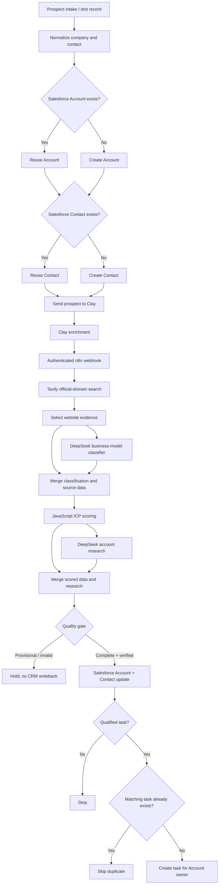

# RevenueOS V2 — Prospecting & Sales Intelligence

**An end-to-end GTM engineering portfolio project** that transforms a raw prospect into an enriched, researched, scored, and actionable Salesforce record.

**Built for:** Lolia, a fictional B2B AI Revenue Intelligence SaaS company  
**Core stack:** n8n · Salesforce · Clay · Tavily · DeepSeek · JavaScript · Gmail/SMTP  
**Project type:** Demonstration and portfolio system; not a production deployment

> **Business outcome:** Reduce repetitive sales-operations handoffs by connecting prospect intake, CRM deduplication, data enrichment, evidence-based account classification, ICP scoring, sales research, CRM writeback, and qualified follow-up tasks.
>
> This project demonstrates working automation, **not a measured claim of revenue uplift, conversion gains, or hours saved**.

## 1. The business problem

A B2B sales team can spend significant time moving prospect information between systems: checking whether an account already exists, enriching incomplete data, determining fit, researching what to say, updating CRM fields, and assigning follow-up. Without controls, this can also create duplicate contacts or tasks and allow low-confidence data into the CRM.

**RevenueOS V2** addresses that workflow as an integrated process, with AI used for interpretation and written research and JavaScript rules used for scoring and execution gates.

## 2. System architecture

A separate n8n **Error Handler** receives failed production executions from the configured workflows, formats error details, and sends an email notification via SMTP.

**Boundary:** The Clay enrichment table and outbound HTTP API action are external configuration and are **not included** in the three n8n workflow JSON exports.

## 3. Workflow modules

| File | Responsibility |
| --- | --- |
| [`01-prospecting-engine.json`](workflows/01-prospecting-engine.json) | Test prospect intake, normalization, Salesforce Account/Contact lookups and creation, preparation and authenticated handoff to Clay |
| [`02-enrichment-sales-intelligence.json`](workflows/02-enrichment-sales-intelligence.json) | Authenticated enrichment receiver, Tavily research, AI business-model classification, ICP scoring, account research, CRM quality gate, Salesforce writeback, qualification and task deduplication |
| [`03-error-handler.json`](workflows/03-error-handler.json) | Error Trigger, error-detail formatting, SMTP email notifications |

### Enrichment data contract

The downstream workflow expects the following fields (from the prospecting/CRM stage and Clay):

| Source | Fields |
| --- | --- |
| Prospecting / CRM | `companyName`, `domain`, `accountId`, `contactId`, `firstName` |
| Company description and firmographics | `companyDescription`, `industry`, `employeeCount`, `revenueUsd`, `revenueStatus` |
| Technographics | `detectedProducts` |
| Growth signals | `growthScore`, `growthScore90DayDelta`, `growthDirection` |

The Clay setup used company firmographic, technology and growth enrichment actions, with data mapped into these names before returning to n8n. Provider coverage and estimates may be incomplete or inaccurate. The raw `industry` field is retained as context; it is **not** the final AI category used for ICP industry points.

## 4. ICP scoring model (100 points)

The ICP is oriented toward **B2B SaaS / business-software companies**, with a preference for roughly **50–2,000 employees**, revenue above **$10 million**, relevant CRM usage, and positive growth signals.

| Dimension | Max points | Implemented rule |
| --- | ---: | --- |
| Business model | 25 | `B2B_SAAS` = 25; `B2B_SOFTWARE` = 20; `MIXED_TECH` = 10; `NOT_ICP` = 0; `UNKNOWN` = 0 |
| Revenue | 25 | Over $10M = 25; $5M–$10M = 15; $1M–under $5M = 5; otherwise 0 |
| Employees | 20 | 50–2,000 = 20; 20–49 or 2,001–5,000 = 10; otherwise 0 |
| Growth | 15 | Up to 15 using supplied growth score, 90-day delta and growth direction |
| CRM technology | 15 | 15 if recognized Salesforce/HubSpot CRM product signals are present; otherwise 0 |

**Fit tiers:** High = **80–100**, Medium = **60–79**, Low = **0–59**.

**Verification is distinct from points.** The classifier supplies a category, supporting quote, confidence estimate and `needsReview`. The scoring code checks whether usable website evidence exists and whether the normalized supporting quote appears in supplied evidence. A score may be calculated but marked **`Provisional`** when verification or required enrichment fields are missing. The quality gate requires `scoreStatus = Complete`, `industryVerified = true`, IDs present, and a valid score before updating Salesforce. A task additionally requires a non-`NOT_ICP` category and score ≥ 60.

**Practical caveat:** A quote found in evidence does not independently prove that the whole-company category is correct. Confidence is model-estimated, not calibrated statistical probability. Human review and stronger evidence checks are sensible for higher-stakes use.

## 5. AI and automation responsibilities

- **Tavily:** Retrieves search snippets from the company's official domain. A JavaScript node filters career pages, prioritizes relevant paths, and selects up to three evidence records.
- **DeepSeek — business-model classifier:** Classifies the company's *primary* model as `B2B_SAAS`, `B2B_SOFTWARE`, `MIXED_TECH`, `NOT_ICP`, or `UNKNOWN`, with a structured JSON output. The classifier model is configured with temperature `0` to reduce variation, not guarantee identical results.
- **JavaScript — ICP score:** Calculates the score deterministically from incoming fields and classification; AI does not freely assign points.
- **DeepSeek — account research:** Summarizes the account, proposes *hypothesized* pain points, suggests a sales angle, drafts short personalization, and notes evidence gaps. It is instructed not to alter the incoming ICP score.
- **Salesforce:** Stores ICP score, fit tier and account research on the Account; writes personalization to the Contact; creates an Account-owner follow-up task when the qualification and deduplication checks allow it.

## 6. Reliability and safety controls

- **Account and Contact deduplication** before creating CRM records.
- **Authenticated handoffs:** n8n-to-Clay uses a Clay webhook credential; Clay-to-n8n uses Header Auth on the inbound webhook.
- **Evidence-aware classifications** and a **Provisional/Complete** status.
- **Quality gate before Salesforce writeback** that blocks incomplete or unverified intelligence.
- **Task qualification** that requires Complete, verified, non-`NOT_ICP` results and score ≥ 60.
- **Task deduplication** via an existing Salesforce Task lookup (`WhatId`, `WhoId`, task-subject prefix).
- **Workflow-level failure notifications** through n8n Error Trigger and SMTP email.

**Current limitation:** Provisional items are held by the quality gate, but the exported workflow does not include a dedicated human-review queue. The task deduplication check is lookup-based rather than a transactional uniqueness guarantee, so concurrent executions could still race.

## Screenshot evidence

The [screenshots checklist](screenshots/README.md) lists the n8n, Clay, Salesforce, deduplication, and error-alert captures planned for this case study. **Real screenshots are not yet uploaded.** Screenshots will be published only after checking for private email addresses, CRM identifiers, tokens, webhook URLs, and customer data.

## 7. Tests performed

The following are **reported functional tests in the project development process**, not independent production benchmarks:

| Scenario | Observed outcome |
| --- | --- |
| Account/Contact new-versus-existing paths | Salesforce lookup and create/reuse paths exercised |
| Amplitude repeated classification/scoring | Five consecutive runs reported consistent after scoring revisions |
| Adobe provisional classification | Routed to the False quality-gate branch; Salesforce was not updated |
| Valid Salesforce writeback | Account and Contact API responses returned `success: true` |
| Eligible new task | Salesforce task creation tested successfully |
| Existing matching task | Existing task was detected and no duplicate task was created |
| Intentional failed production execution | Configured Error Handler executed and email notification worked |

These tests support the demonstrated workflow behavior; they are not proof of universal classifier accuracy, high availability or financial ROI.

## 8. Local setup / reproduction

**Prerequisites:** A running n8n instance, Salesforce environment with suitable API access and custom fields, Clay workspace with required enrichments, Tavily and DeepSeek API access, and optional SMTP credentials for error notifications. A public HTTPS address (e.g., a Cloudflare Tunnel) is needed for Clay to reach local n8n.

1. Import the three JSON files into n8n.
2. Reconnect the Salesforce OAuth, DeepSeek, Tavily, Webhook Header Auth, Clay HTTP Request Header Auth, and SMTP credentials. **No live credentials are included in this repository.**
3. Configure the Salesforce Account fields for domain, ICP score, fit tier and research, and the Contact personalization field. Match the actual API names in the imported nodes (`Domain__c`, `RevenueOS_ICP_Score__c`, `RevenueOS_Fit_Tier__c`, `RevenueOS_Account_Research__c`, and `RevenueOS_Personalization__c`).
4. Replace the placeholder **Clay webhook URL** in Workflow 1 and the placeholder **Salesforce organization domain** in Workflow 2.
5. Configure Clay to receive the prospect from Workflow 1, map and enrich the required fields, and send a JSON `POST` to Workflow 2's webhook with the matching Header Auth secret.
6. If n8n is local, configure the public HTTPS tunnel for Workflow 2's production webhook and update Clay's endpoint when using a temporary tunnel hostname.
7. In each main workflow's **Settings**, select the imported Error Handler as the **Error Workflow**. Set the sender and recipient email fields in the Error Handler to an address you control, and check that the full message body is in the appropriate node field for your n8n version.
8. Run an end-to-end test with a **fictional or authorized test contact**, and confirm the Salesforce update and task outcomes. Then run a duplicate scenario and a Provisional scenario.
9. Publish workflows as needed. For the existing Workflow 1 export, intake begins with a **manual test trigger**; replace it with a suitable production source/trigger for real unattended prospect ingestion.

> **Import safety:** These are **sanitized demonstration exports**. Their credentials, private endpoints, webhook path and workflow settings have been removed or replaced. They are not plug-and-play production workflows.

## 9. Security and privacy

- Never commit OAuth tokens, API keys, SMTP App Passwords, webhook authentication secrets, customer records or personal test data.
- Store sensitive values in n8n credentials and use the appropriate secured connector settings.
- Use example prospect data and review pinned executions and screenshots before publishing.
- Because this repository contains redacted workflows, do not treat the supplied placeholder endpoints as active integrations.

## 10. Roadmap

- Add a structured **human-review queue** for provisional/contradictory classifications.
- Improve evidence validation beyond substring matching, and log sources/freshness.
- Add tests for missing revenue, missing product signals, malformed IDs and downstream API failures.
- Add durable idempotency for simultaneous task-creation requests.
- Track execution metrics such as enrichment completeness, qualification rates, failure rates and sales response time.
- Replace temporary local tunneling with a reliable deployment where appropriate.

## 11. Suggested demo narrative

1. Introduce a **new authorized test prospect**.
2. Show Account and Contact resolution in Salesforce.
3. Show enrichment returned by Clay and evidence retrieved by Tavily.
4. Walk through AI classification and the deterministic ICP point breakdown.
5. Demonstrate a successful Salesforce writeback and eligible task creation.
6. Re-run the prospect to show that an existing task is detected and skipped.
7. Show how Provisional data is held and how failed production executions generate an error notification.

---

**Disclaimer:** Lolia is a fictional portfolio company. Companies mentioned in tests are illustrative research subjects; this project is not affiliated with those companies, Salesforce, Clay, n8n, Tavily or DeepSeek.